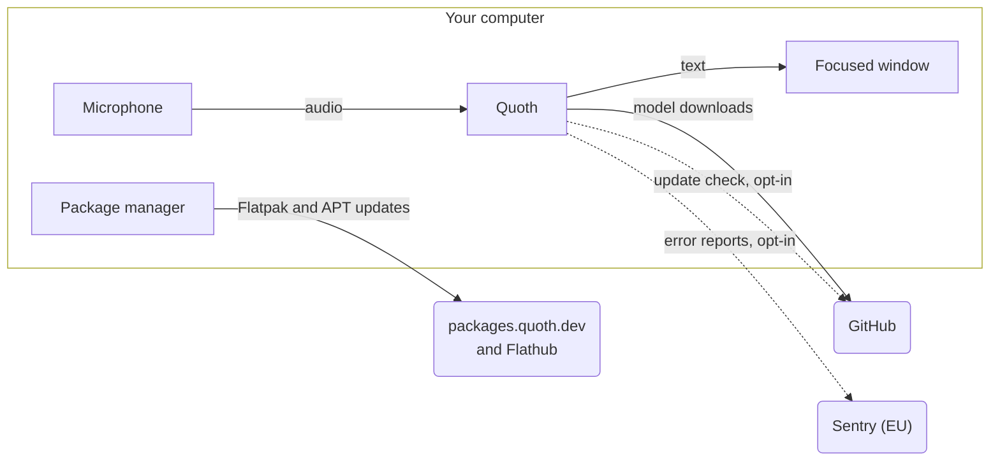

# Privacy notice

Last updated: 10 November 2026

This notice covers the Quoth app. Quoth transcribes on your computer and never
sends your audio or dictated text anywhere. There is no account.

These are the only connections that leave your computer; the dotted ones stay
off until you turn them on:

## Who is responsible

Samuel Ruairí Bullard, Quoth's maintainer, is the controller for the error
reports described below. Contact:
[samuel.ruairi.bullard@gmail.com](mailto:samuel.ruairi.bullard@gmail.com).

## Error reports

Error reports are off by default. Quoth sends them only after you turn on
**Send error reports**, during first-run setup or in Settings → General. A
repeated failure is reported once per run.

A report contains:

- the error's type, severity and how it was caught, the code locations it
  passed through (file path, module, function and line) and, for a system
  error, its error number;
- the time, Quoth's version, whether it is a release, test or development
  build, and the Sentry SDK version;
- your distribution (or the Flatpak's runtime), your desktop's name, whether
  Quoth is a Flatpak or a system package, whether it was using the CPU, GPU or
  NPU, and whether Intel NPU acceleration started.

Quoth keeps the stack of its most recent native crash on your computer and
sends it once reports are on. It holds the signal that stopped Quoth, each
thread's code locations, any native call stack (library paths, function names
and memory addresses) and the names of loaded Python extension modules. Home
folder paths are replaced with `~` before anything is sent.

A report never contains audio, dictated text, exception or log messages,
variable values, your username or computer name, or an identifier that links
reports to you or to each other.

**Purpose and legal basis.** Reports are used only to find and fix bugs in
Quoth. The legal basis is your consent (GDPR Article 6(1)(a)). Reporting is
optional, and Quoth works the same with it off.

**Recipient.** Sentry (Functional Software, Inc.) processes reports for Quoth
under a data processing agreement and stores them in its EU region in
Frankfurt, Germany. Any transfer outside the EU, such as support access, is
covered by the EU-U.S. Data Privacy Framework, with the EU's standard
contractual clauses as a fallback.

**IP address.** Sentry sees the IP address a report comes from, but is set to
store neither the address nor a location derived from it.

**Retention.** Sentry keeps reports for at most 90 days.

**Withdrawing consent.** Turn off **Send error reports** in Settings → General
and Quoth stops sending reports. Reports already sent stay until Sentry deletes
them, and withdrawing does not affect reports sent while consent was given.

## Your rights

Under the GDPR you can ask for access to your data, its correction or deletion,
restriction of its processing, or a copy in a portable format, and you can
withdraw consent at any time. Because reports carry no identifier, the
maintainer usually cannot tell which reports are yours (GDPR Article 11). If you
say roughly when a report was sent and what went wrong, the maintainer will look
for it and delete it. You can also complain to a data protection supervisory
authority, such as the one where you live.

Quoth makes no automated decisions about you, including profiling.

## Other connections

- **Model downloads** come from Quoth's releases on GitHub.
- **The update check**, off by default, asks GitHub for the latest release at
  most once a day, and **Check now** in Settings asks right away. The request
  carries Quoth's version.
- **Flatpak and APT updates** come from `packages.quoth.dev`, served by GitHub
  Pages. The Flatpak's GNOME runtime comes from Flathub.

GitHub handles its requests under the
[GitHub General Privacy Statement](https://docs.github.com/en/site-policy/privacy-policies/github-general-privacy-statement).
Quoth's maintainer receives no personal data from GitHub or Flathub.

## On your computer

- Dictated text never reaches Quoth's log file. Only `QUOTH_LOG_LEVEL=TRACE`, a
  developer option, prints it, and only to a terminal.
- Quoth pastes through the clipboard, then puts back the plain text that was
  there; anything else, such as an image or formatting, is cleared. While your
  dictation is on the clipboard, any program running as you can read it, and a
  clipboard manager that ignores Quoth's sensitive-content hint can keep it.
  When a paste fails, or you use **Copy last dictation**, it stays there until
  something replaces it.
- Quoth keeps your last dictation in memory until it quits, for **Copy last
  dictation** in the tray.
- Quoth counts your dictations, with the date of the first, for the usage
  summary in Settings and, after 100 dictations, a one-time invitation to
  support Quoth. The count stays on your computer.

## Changes

Changes to this notice are listed in the release notes.
